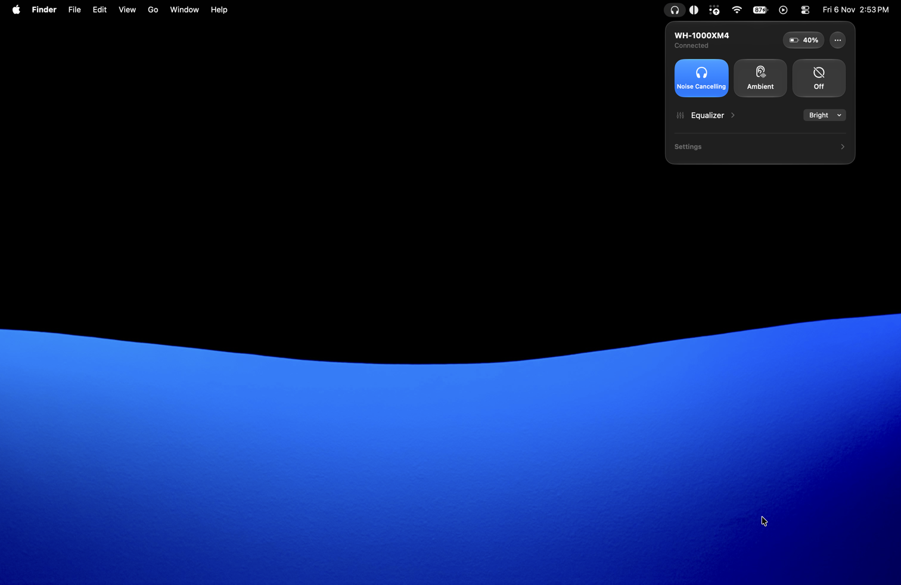
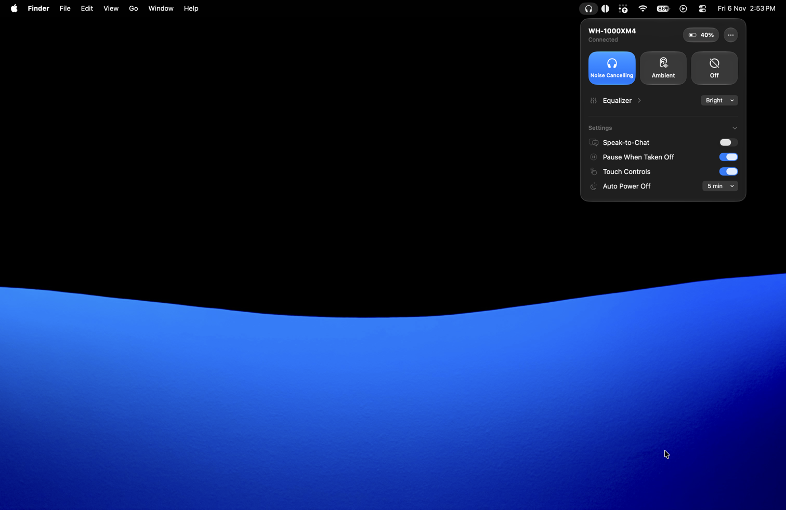

# Hush

A tiny macOS menu bar app for the **Sony WH-1000XM4**: Sony's headphone
settings, on your Mac. No dependencies.

<p>
  
  
</p>

- Noise cancelling / ambient / off, ambient level, focus on voice
- Battery level
- Equalizer presets and a 6-band custom EQ
- Speak-to-Chat, pause when taken off, touch controls
- Auto power off after a stretch with no audio, or turn off now

Launch it from Spotlight when you need it, quit it from the `…` menu.

## Install

Needs macOS 26 and the Xcode Command Line Tools (`xcode-select --install`).

```sh
scripts/build-app.sh --install   # builds and copies Hush.app to ~/Applications
```

Allow Bluetooth access on first launch. The app is ad-hoc signed for your own
Mac only.

## Development

```sh
scripts/test.sh                  # protocol unit tests
scripts/build-app.sh --debug     # run with debug control, then:
build/hushctl status             # query and drive the app from the terminal
build/hushctl log -f             # every byte sent and received
```

`Sources/HushCore` is the protocol (framing, commands, session state machine)
with no Bluetooth or UI, fully unit tested. `Sources/Hush` is the app.
`scripts/probe.sh` sends read-only queries to explore what the headphones
support.

Note: SwiftUI's `@State` macro plugin isn't in the Command Line Tools, so
views use `@ViewState`, a plain alias for `State`.

## Credits

The protocol details were cross-checked against
[Gadgetbridge](https://codeberg.org/Freeyourgadget/Gadgetbridge),
[SonyHeadphonesClient](https://github.com/Plutoberth/SonyHeadphonesClient) and
[sony-connect-osx](https://github.com/tanat/sony-connect-osx). They were read
for reference only; none of their code is used.

Not affiliated with Sony.
